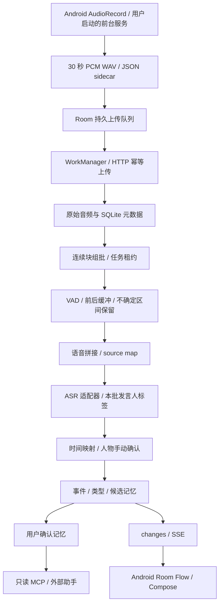

# EchoLedger 项目架构报告

版本 0.1.0 · 2026-11-02。本文描述交付代码的现状，并标出后续扩展。平台事实来源见 [SOURCES](SOURCES.md)，执行证据见 [TESTS](TESTS.zh-CN.md)。

## 1. 产品目标与边界

用户主动启动日常录音后，系统连续保存音频，把有声片段转写为带来源的文本，按真实时间展示事件，维护人物和事件类型，并允许外部助手通过只读 MCP 查询经过确认的记忆。参考截图用于确定深色时间线、人物标签和正在录音卡片等交互方向；本项目没有复用原应用的代码，也不声称复现了它的内部实现。

MVP 以单用户、单个服务端、单机 SQLite 为部署范围。用户手机可以断网继续保存，服务端模型可以替换，原始音频和派生结果分开保留。录音停止、服务被系统结束或发生明显采样缺口时，时间线上保留实际断点。

## 2. 模块与数据流



| 层 | 当前代码 | 输入和输出 | 替换方向 |
|---|---|---|---|
| 录音 | `capture/`、`core/WavFile.kt` | PCM → WAV、采样时钟、会话 | 蓝牙设备、文件导入、编码器 |
| 本地数据与同步 | `data/`、`network/UploadWorker.kt` | 文件 → 持久队列 → 服务端 | 上传策略、端侧处理、可恢复传输 |
| 预处理 | `audio.py`、`vad.py` | 原音频 → 区间、拼接音频、映射 | Silero/WebRTC/其他 VAD、降噪 |
| 语音处理 | `providers.py` | 拼接音频 → 文本、局部标签、时间戳 | 云 ASR、本地 ASR、声纹模型 |
| 后处理 | `pipeline.py`、`speakers.py`、`queries.py` | 文本 → 事件、人物关联、记忆 | 语义聚合、记忆抽取、向量搜索 |
| 对外服务 | `api.py`、`mcp.py` | 查询/命令/变更流 | 多用户认证、官方 MCP SDK |
| 界面 | `ui/` | 本地缓存与录音状态 → Compose | 分页、编辑、音频波形、筛选 |

Android 当前采用 `:core` 与 `:app` 两个 Gradle 模块；`app` 内按包划分职责。后续可以把 capture、sync、timeline、memory 抽成独立模块。服务端保持模块化单体，队列使用数据库事务，避免一开始依赖 Redis、Kafka 或微服务集群。独立 worker 入口已经提供，但共享 SQLite 文件的多主机运行不在支持范围内。

## 3. 录音如何分块

### 3.1 物理块

AudioRecord 使用单声道、16 kHz、PCM16，持续读取 512 个样本的缓冲区。每累计 480000 个样本关闭一个 30 秒文件，再立即向下一个文件写入；边界处不重启麦克风。最后一个块可以不足 30 秒。

固定时长落盘让断电恢复、重试上传、校验和磁盘管理都围绕一个有界对象进行。每块保存 `session_id`、`seq`、`start_sample`、`sample_count`、SHA-256、对应单调时钟与系统时间漂移。不能只保存“第几分钟”或文件创建时间。

录音先写 `.wav.part` 和 sidecar，完成时修正 WAV 长度、同步并重命名。采集中约每 5 秒同步一次。启动恢复逻辑检查未完成文件，按实际 PCM 字节数修复头部，舍弃不足一个 PCM16 样本的尾字节，并重建队列。它降低故障损失，但无法承诺断电时零丢样本。

Android 实现使用麦克风前台服务、运行时权限和可停止的常驻通知。Android 14 起对服务类型及麦克风权限有明确要求，后台启动仍有限制，见来源 [1][2]。应用使用 `START_NOT_STICKY`，不会通过开机广播或无交互自动恢复监听。

### 3.2 处理批次

服务端按会话和连续序号选取最多 4 个物理块，形成约 120 秒处理批次。首个待处理块等待达到 90 秒、会话已结束或用户请求 flush 时，会提交不足 4 块的批次。缺序号时等待缺块，不能把不相邻的采样数据假装成连续录音。

每批额外读取上一块最后 1 秒作为左侧上下文。当前采用原始样本中点归属来过滤只落在上下文中的识别结果，减少重复。它属于工程启发式：跨边界词语的真实效果仍需长录音测试；后续可增加右侧 look-ahead、短语去重和批次内状态延续。

物理块无需等待 VAD，处理批次可以重跑。VAD 结果、每帧概率、模型 SHA 和配置快照保存在派生目录，不改写原始块。未来增加端侧 VAD 时，应继续使用同一组原始样本编号与 source map 协议。

### 3.3 时间映射

一个会话启动时记录 UTC 毫秒锚点和单调时钟。样本 `s` 的时间为：

```text
utc_ms(s) = session.started_at_ms + floor(s × 1000 / 16000)
```

内部运算使用整数，避免长时间浮点累计误差。跨时区展示由客户端负责；数据库保存 UTC 和会话时区偏移。系统时钟跳动记录为 drift，不改写已建立的样本时间线。若采样时长与单调时间相差超过 5 秒，则停止本会话并提示重新开始；不能补出不存在的录音。

删除静音后，每个保留片段记录：拼接起止样本、原始会话起止样本、原块 ID 与块内偏移。ASR 返回的拼接时间先映射回多个来源区间，再得到真实 UTC 时间。人工插入的分隔静音没有来源。当前分隔时长至多 120 ms，且不超过实际删去的空隙。

例如原录音保留 `[0,5)` 秒和 `[60,70)` 秒，压缩后的约 15 秒音频仍能分别指回原录音的 0–5 秒及 60–70 秒。跨越中间空隙的识别片段会携带多个 `source_spans`，不能把它的时间包络解释成连续说话。

## 4. VAD 与参数版本

`FrameScorer` 负责逐帧概率，区间切分、迟滞阈值、短语长度过滤、静音结束阈值与 padding 分开实现。Silero 适配器按官方 ONNX 示例的输入结构实现；实际模型权重未包含在交付包中，也未在本环境执行推理。来源 [4] 解释支持的采样率和模型用法。

默认 profile：开始阈值 0.35、结束阈值 0.20、最短语音 96 ms、最短静音 800 ms、两侧 padding 各 300 ms；开启不确定区间保留，阈值 0.12。这些是待校准的保守起点，无法用于宣称任何场景下的准确率。

用户可以调整 profile，并保存新版本。批次入队时引用当时的 profile，后续修改只影响新批次。调低阈值往往增加保留量；调高阈值、缩短 padding 可能提高裁剪比例，也可能漏掉轻声和短回应。UI 用场景试录、回听与指标解释辅助调整，参数试算不会自动激活。

默认 `passthrough` 不删音频，便于先建立端到端链路。`energy_demo` 只有示范价值，不能区分机器声和人声。模型初始化失败会阻止服务启动，处理过程中的错误会进入任务状态，避免静默切换到会丢语音的简化算法。

## 5. ASR、人物与记忆

### 5.1 转写

`Transcriber` 契约接收 16 kHz PCM16 数组，返回文本、起止时间、批次内发言人标签、时间精度及 provider 使用量。Gemini REST 适配器参考官方音频转写接口，实现词级时间信息与局部分人标签解析；另外保留结构化 JSON 转写模式。模型名称由配置指定。来源 [5][6]。

输入与处理配置的指纹决定缓存路径。已缓存结果重试时可以复用，API 层幂等可阻止重复入库；远程服务成功后、本地缓存落盘前崩溃仍可能重复计费，因此本项目不承诺外部调用 exactly-once。每次外部调用前按 UTC 日预留音频秒数，预算用尽后保留任务，供用户决定是否重试。

### 5.2 发言人分离与身份

ASR 的 `speaker_1` 在每个批次中独立命名，完整键为 `batch_id:label`。人物库保存用户命名的人，手动绑定默认只影响同一批次的同一标签。跨批次同名标签不能自动认为是同一个人。

已实现外部 embedding 注册和 cosine 匹配：向量按模型版本隔离，注册要有来源片段和 consent，匹配需同时满足相似度阈值与前两个人候选分差。拒绝时返回 unknown。相似度不是概率，默认阈值 0.80 与 margin 0.10 都需要针对具体声纹模型重新校准。

本版本尚未接入“从音频提取声纹”的模型，也未实现自动跨日识人。预留 `SpeakerEmbedder`/`SpeakerIdentifier`；以后应在原始未压缩的干净片段上取声纹，并拒绝太短、重叠、噪声过重的注册样本。

### 5.3 事件和记忆

当前每个完成的处理批次生成一个事件，关键词匹配决定初步类型，标题和摘要取自转写摘录。事件类型可以新增或修改；用户可修订标题、类别。尚未实现像截图中那样把一小时谈话自动聚合为一个完整活动。后续事件聚合应综合静音间隔、话题和人物变化，并保留所包含的所有批次与来源片段。

记忆默认为候选转写摘录，用户确认后才进入 `search_memories` MCP 工具。数据库保留 event/segment/source_spans 证据链。搜索使用中文可用的子串匹配，未实现 embedding 检索、事实抽取、矛盾消解或自动画像。`MemoryExtractor` 当前仅为扩展契约，尚未连接高级抽取实现。

## 6. 持久化、任务状态与实时更新

数据库核心表为 sessions、chunks、batches、profiles、segments、speakers、voiceprints、event_types、events、event_segments、memories、changes、calibrations、usage 与 deleted_sessions。完整 DDL 见 `DATA_MODEL.sql`。

上传按 `(session_id, seq)` 幂等，比较完整元数据与内容哈希；同序号不同内容返回 409。进程中断后，任务从租约超时状态重新领取。工作租约为 10 分钟，最多 5 次自动尝试；可恢复的网络错误退避重试，配置缺失或预算用尽标记 blocked。MVP worker 单线程，SQLite 事务保护领取和提交。

业务写入与 changes 记录处于同一事务，SSE 按 cursor 发送变更。客户端前台连接 SSE，接收到变更后刷新 Room；Compose 订阅 Flow。断开重连使用 cursor 继续读取，页面首次进入还会主动刷新。录音计时和音量来自本地 StateFlow，不等待服务端。

UI 实时响应不表示逐词实时转写：当前转写等待文件落盘、上传、组批和模型处理。WorkManager 的运行时机由系统调度，也不能保证每 30 秒准时上传，见来源 [3]。

## 7. 删除、安全和隐私

会话删除会删除其原音频与派生文件，并通过外键级联删除文本、事件、记忆和依赖证据的声纹。保存会话 tombstone，防止离线设备重新上传已删除内容。手机本地也保存删除状态以避免恢复扫描把文件重新加入。单独删除一条记忆不会删除其录音。预算计数保留，用于避免通过删除内容绕过额度。

这不是取证级安全擦除：SQLite WAL、磁盘快照和外部备份可能仍有旧字节，已经送达模型提供方的请求也无法撤回。数据保留策略、备份生命周期和密钥销毁需要在正式部署前确定。

Android API 令牌使用 Keystore 保护，录音存内部目录并禁用 Android 自动备份。Release 强制 HTTPS。服务器原音频目前没有应用层加密，应使用受控主机、磁盘加密和最小访问权限。

API_TOKEN 可写；MCP_TOKEN 为不同的只读密钥，只能访问四个查询工具。MCP 检查 Origin，避免把音频下载、修改记忆和系统操作暴露给助手。转写中的文字具有不可信数据属性；外部 agent 必须防止录音中的提示词注入。当前没有 OAuth、账号体系、细粒度多租户权限或公网限流。

## 8. 后续扩展顺序

先完成 Android 整包编译及真实设备稳定性测试、真实 Silero/Gemini 联调、独立录音集校准。随后加入端侧 VAD 和 Opus 上传以减少网络流量，再增加自动声纹提取、跨批次事件聚合与有证据的语义记忆。多用户、端到端加密、向量数据库和实时 ASR 应在数据契约稳定后加入。

扩展应保留原始采样编号、版本化配置、证据引用与 unknown 状态。现有接口降低替换成本，但仍需测试来验证新增模块之间的兼容性。
